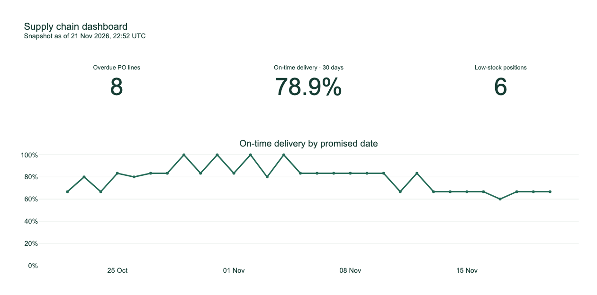

# Supply Chain Dashboard

A supply-chain monitoring project that uses n8n, PostgreSQL, and Quadratic AI to track overdue purchase-order lines, on-time delivery, and low stock by warehouse and SKU.

[View the Quadratic dashboard](https://app.quadratichq.com/file/457ba556-a56a-42a5-8906-ee9f5d53c4e8) · [View the portfolio project](https://sanishpaniker.netlify.app/#supply-chain-dashboard)

- **n8n** generates purchase-order and inventory records and loads them on a 15-minute schedule when running.
- **PostgreSQL** validates batches, updates records by their source keys, and calculates the dashboard metrics.
- **Quadratic** displays delivery trends and exception queues. The public view uses a workbook snapshot.

## Run the project

Download [the source bundle](supply-chain-dashboard.zip), extract it, and open the included README for Docker Compose, n8n import, PostgreSQL, and live Quadratic refresh setup. The [workflow](supply-chain-workflow.json) and [database schema](schema.sql) are also available here for review.
